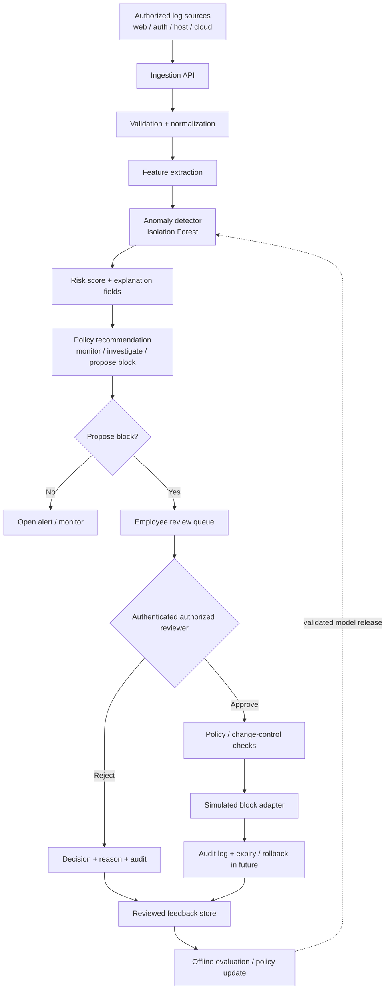

# Architecture and component design

## Logical architecture

## Repository implementation today

- `app/main.py`: FastAPI endpoints, alert lifecycle, approval decision, simulated block records.
- `app/detector.py`: synthetic-baseline Isolation Forest and feature extraction.
- `app/policy.py`: small feedback-driven recommendation policy.
- `app/schemas.py`: Pydantic request validation.
- `app/store.py`: simple local JSON / JSONL persistence.
- `scripts/train.py`: training example for reviewed JSONL data.
- `tests/`: starter tests.

## Event lifecycle

1. **Ingest:** validate the request shape and IP address.
2. **Normalize:** in a production collector, normalize timestamps, proxy headers, user IDs, and event types before scoring.
3. **Extract:** convert an event and recent per-IP context to a numeric feature vector.
4. **Score:** the Isolation Forest returns a decision function. The demo maps it to a bounded score from 0 to 1.
5. **Recommend:** policy thresholds map score ranges to a recommendation.
6. **Review:** a reviewer approves or rejects a proposed block and supplies a reason/ticket.
7. **Enforce:** in this repository, approval only records a simulated block. A real adapter is intentionally absent.
8. **Learn:** review outcomes are logged. They should be curated and evaluated offline before updating any deployed model.

## Trust boundaries

- Log producers are untrusted inputs: validate size, schema, timestamp, and encoding.
- The API must be authenticated before exposure beyond localhost.
- Reviewer identity must come from a verified identity provider, not a client-supplied string.
- The model is advisory; it must not have direct authority to change network controls.
- Audit storage must be protected from deletion or alteration in production.
- A firewall adapter should be isolated behind a narrow interface and least-privilege credentials.

## Recommended production separation

Split the prototype into services or modules when scaling:
- Collector / message queue
- Feature service
- Versioned model-serving service
- Alert and case-management service
- Identity-aware approval service
- Enforcement adapter with expiry and rollback
- Append-only audit store
- Offline training and evaluation pipeline

## Availability and performance design

For larger event volumes, use a queue and batch scoring rather than synchronous per-event disk reads. Partition by time, use bounded state windows, add backpressure, and define behavior during model or queue outages. Fail closed for enforcement: if approval, identity, audit, or policy checks are unavailable, do not apply a block.
